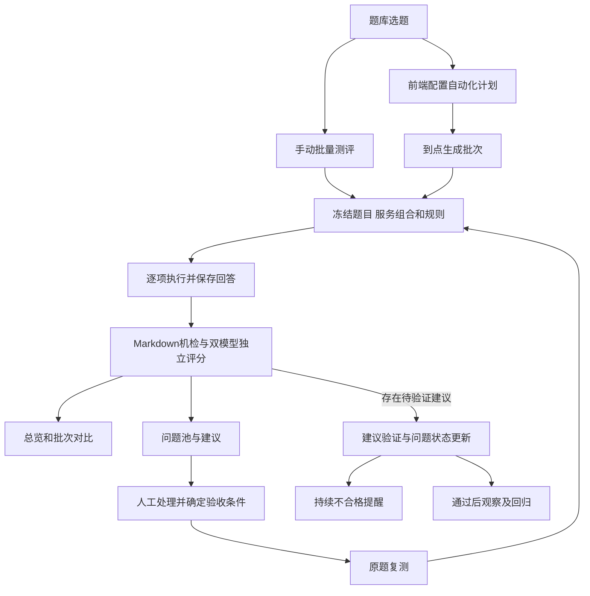
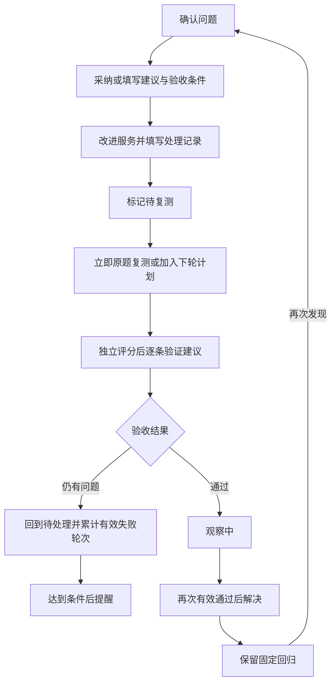

# Science 评测平台批量评测与质量跟踪产品方案

版本：v1.0 草案

日期：2026-10-30

状态：待产品评审

范围：批量测评、总览、评测规则、自动化计划、建议复测与提醒。

平台下一阶段围绕一条流程展开：从题库选题，手动或定时批量调用适用服务，独立评分并汇总问题，维护改进建议，再用原题复测验证，持续表现差时提醒处理。用户应能在前端配置计划和规则，每天直接看到昨夜结果、当前问题及改进进展。

本文中的新增功能均为拟议方案。当前阶段只整理产品设计，不修改业务代码，不启用定时任务，不调用真实服务，不修改线上数据，不提交或部署。

## 1 目标与产品边界

### 本阶段目标

1. 一次选择多道题，也能让同一道题调用多个适用服务，逐项保存结果。
2. 用总览和对比表回答今天测了什么、哪些服务表现差、哪些问题需要处理。
3. 让维护者以文档和表单维护评测标准，并保留每次运行使用的规则版本。
4. 在前端配置夜间计划，按总量组合常规题、昨日低质量题和待验证题。
5. 把建议变成有验收条件的事项，保存处理和复测证据，跟踪改善及复发。
6. 对持续低质量、修复后仍失败和执行故障分别提醒。

### 当前基础与新增范围

| 模块 | 当前本地代码具备的基础 | 本方案新增 |
| --- | --- | --- |
| 题库 | 领域、固定及随机题、导入、生成预览与确认入库、版本、编辑和软删除 | 批量选题、题集引用、复测标记 |
| 单题运行 | 文献检索、航空文献、合金材料、合成制备、新材料五类服务；流式结果、持久化、恢复与历史 | 多题和多服务的批次组织、队列、批次恢复 |
| 结果 | Markdown、公式、结构化结果与成果预览 | 同题多服务、同题多轮对比 |
| 评分 | DeepSeek 与千问独立评分、任务完成度、原文 Markdown 机检、单次建议、仅重新评分 | 可维护规则版本、聚合口径、建议验收与质量趋势 |
| 自动化 | 独立后端保留自动运行衔接能力，原夜间调度尚未迁入 | 前端计划配置、持久调度、自动选题、回归与提醒 |

上述基础不表示已部署，也不表示完成了五服务批量真实验收。新平台接管生产调度须与既有管理后端迁移协调，防止两个调度器重复执行。

### 本阶段边界

先围绕现有五类服务和已入库题目落地。夜间不直接生成并保存未经确认的新题。建议用于人工改进和输出验证，平台不自动修改被测服务的代码、配置或提示词。

多人独立打分、公开排行榜、周报群发布、数学建模参考基准、自动科学事实核验和完整报告导出列为后续扩展。现阶段模型评分表达对可用证据的判断，专业性得分不等于科学正确率。

## 2 对象和数量口径

| 对象 | 含义 | 主要关联 |
| --- | --- | --- |
| 题目版本 | 一次冻结的题面与题库版本 | 来源领域、题集、可用服务范围 |
| 题集 | 可复用的一组题目版本，首版支持将当前选择保存为题集 | 清单修改产生新修订，已有批次保留原清单 |
| 运行项 | 一个题目版本调用一个服务的一次原始测评 | 批次、服务信息、回答、执行和评分状态 |
| 评测批次 | 一次确定了题目和服务组合的任务 | 人工或计划来源、规则快照、运行项、汇总 |
| 自动化计划 | 周期、题目范围、数量、服务和规则等配置 | 每次触发产生一个独立批次 |
| 规则版本 | 发布后固定的评分与质量判断标准 | 两家评委共用，批次记录实际使用版本 |
| 问题记录 | 某题在某服务上的一种持续问题 | 多次发现记录、建议、复测、提醒 |
| 建议与验证 | 具体改进动作和事先明确的验收条件 | 建议来源、处理记录、逐轮验证证据 |

题目数按题目 ID 和版本去重；运行项数按题目版本和服务组合计算。例如 10 道题各测 3 个服务，题目数为 10，运行项数为 30。相同组合在同一批次只创建一个原始运行项。

自动化的常规题、昨日低质量题、待验证题共同占用总题数配额。相同题目同时出现在多个来源时按优先级归类一次，所需服务集合合并，预览重新计算实际运行项数。人工追加重跑保留为新的尝试，关联原项，不覆盖原回答，也不把重试次数当成新增题目。

同一答案仅重新评分，不产生新的被测服务运行，不计作一次服务复测，不增加连续不合格或连续通过次数。

## 3 页面结构与导航

沿用现有侧栏、浅深色主题和以内容为主的阅读布局。新增管理页面使用紧凑的筛选和表格；现有单题回答继续使用对话阅读方式。

| 一级入口 | 页面或子视图 | 主要用途 | 主要操作 |
| --- | --- | --- | --- |
| 总览 | 今日、指定日期、昨夜任务区 | 看执行结果、问题和改进进展 | 新建测评 |
| 新建测评 | 单题、批量 | 发起即时测评 | 开始测评 |
| 评测记录 | 批量任务、单题运行 | 查批次及既有运行记录 | 查看详情 |
| 题库 | 现有列表及题集入口 | 维护、选择和复用题目 | 加入批量测评 |
| 问题与改进 | 问题列表、问题详情 | 建议、处理、复测和趋势 | 发起复测 |
| 自动化计划 | 计划列表、编辑页、执行历史 | 设置定时任务 | 新建计划 |
| 评测规则 | 规则列表、编辑与预览、版本历史 | 维护并发布规则 | 新建版本 |

通知通过全局铃铛和通知列表进入，点击提醒到问题或批次详情。每个页面只突出一个主要动作，其他操作放在次级按钮或更多菜单。

宽表在自己的容器内滚动，首列和表头按需固定；长回答进入详情阅读。手机端显示关键列和详情入口，配置表单分步展示。加载、空状态、部分失败和权限不足均有明确文案。

## 4 页面设计

### 总览

顶部提供日期、服务、领域和来源筛选，默认北京时间当日。常用快捷项为今日、昨日、近 7 天。总览内容自上而下分为：

1. 当日概况：题目数、运行项数、执行中、执行成功和失败、评分覆盖情况。
2. 昨夜任务：最近一轮夜间批次的进度、未完成项和异常，明确标注归属日期。
3. 服务对比：服务、有效样本数、运行成功率、两家评委分别的任务完成率及得分、Markdown 问题数。
4. 问题与改进：新增问题、待处理、待复测、观察中、已解决和持续不合格；点击进入筛选后的问题列表。
5. 当日批次表：名称、来源、题数、运行项数、执行进度、评分状态、问题数、开始时间和详情入口。

日期以批次归属日筛选：手动批次采用创建日，定时批次采用计划触发日。例如 10 月 30 日 23:00 开始、31 日 02:00 结束的任务属于 30 日夜间批次。31 日总览仍在昨夜任务区展示它，避免与 31 日新任务合计混用。跨日运行中的任务也能从该区域进入。

统计口径必须可见：

| 指标 | 统计方式 |
| --- | --- |
| 执行进度 | 已终结原始运行项数 / 本批次确定的运行项数，并拆出成功、失败、未执行和取消 |
| 运行成功率 | 成功 / 已结束且实际发起的运行；未执行、取消和状态待核对项另列 |
| 评分覆盖 | 按评委分别显示有效评分数 / 可评分回答数，同时显示失败、待评分和不可评分数量 |
| 任务完成率 | 按评委分别计算 completed / 可判定的有效样本数；partial 和 failed 计入分母，unclear 另列 |
| 得分 | 按服务及可比规则组，分别展示两家评委均分与有效样本数；缺失评分不补零 |
| Markdown 问题 | 展示有错误的回答数、错误总项数与检查不完整数量 |

随机题集的每日均分用于观察分布；同题改进和跨服务对比使用共同题集。页面同时标明共同样本数，样本或规则不同的组分别展示。

### 新建批量测评

采用三步流程，用户可以返回修改，选择不会丢失。

| 步骤 | 页面内容 | 校验与反馈 |
| --- | --- | --- |
| 选择题目 | 从题库勾选、使用已有题集、按领域抽取；显示已选题数 | 空选择不能继续；展示题目版本和来源 |
| 分配服务 | 为整组选择服务，再按题或领域调整；支持同题多服务 | 沿用旧服务型题目的约束；未配置服务不可启动；领域不代表所有服务均适用 |
| 规则与确认 | 选择已发布规则、填写可选名称、查看题目和服务组合、并发及预计规模 | 显示题数、运行项数、预计评委调用量；无效组合逐项指出 |

确认后生成固定清单，题库后续修改不改变本次任务。选题、预览、保存配置均不发起被测服务调用，只有开始测评才进入队列。

### 批次详情与结果对比

顶部显示批次名称、人工或计划来源、归属日、规则版本、执行与评分进度。操作包括暂停派发、恢复派发、停止后续派发、补跑执行失败项、重评评分失败项。

暂停和停止均影响尚未派发的项，已经运行的项按服务原有超时收尾；页面明确显示这一行为。首次版本不承诺远程取消被测服务已经启动的任务。

主体提供三个视图：

| 视图 | 主要列或内容 | 用途 |
| --- | --- | --- |
| 运行明细 | 题目、领域、服务、执行状态、两家评分、任务完成度、Markdown、问题标记、尝试次数 | 排查某一项 |
| 同题对比 | 行为题目，列为服务；每格分别显示两家结果及状态 | 比较同题不同服务 |
| 问题摘要 | 高频问题、典型证据、涉及服务和题目、建议与待复测项 | 决定下一步处理 |

点击单元格进入既有运行详情，也可以选择两个结果并排或上下对比。只显示实际执行的组合，未选择的服务显示未测。

原始结果保持不变。补跑和重评分保留关联与历史，批次可以显示最新有效尝试，但必须能切回首轮结果，并标注汇总采用的轮次。首轮失败率和补跑后的恢复情况分别显示。

确定性统计始终可用。AI 摘要引用具体运行或问题作为依据；摘要生成失败时保留统计和人工查看入口，允许单独重生成摘要。

### 评测规则

规则通过结构化表单维护可计算内容，通过 Markdown 维护说明、示例和补充要求。两部分合成一份可阅读、可导出的规则文档，避免并行维护两套标准。

| 编辑区 | 可维护内容 |
| --- | --- |
| 基本信息 | 名称、版本、适用服务和领域、变更说明 |
| 评分维度 | 维度定义、权重、分数段说明、正反示例 |
| 图文适用性 | 什么任务需要图表、代码等辅助，什么任务不适用及权重重分配方式 |
| 任务完成度 | 要求提取标准、关键要求、证据标准、完成或部分完成的判定 |
| 机检与关注条件 | 已支持检查项的开关、错误级别和是否进入问题池；质量合格线 |
| 建议与输出 | 评语格式、改进建议要求、建议验收条件的写法 |
| 完整预览 | 将实际评测使用的规则合成可读文档，并支持导出 Markdown |

初始模板承接现有标准：可读性 40%、专业性 40%、图文辅助 20%；图文不适用时其余两项各 50%。任务完成度与 Markdown 检查分别呈现。DeepSeek 与千问独立输出分数，不自动求两家平均。

通用规则、服务补充标准和题目明确要求共同形成当次评测标准；题目自带的验收要求不得在切换通用规则时丢失，冲突需在启动前解决。建议默认每位评委判定合格需同时满足分数达到合格线、任务完成且关键要求满足、输入与证据足以判断；证据不足显示无法判断。Markdown 错误独立进入格式问题，是否作为合格门槛由发布规则明确。

状态为草稿、已发布、已归档。草稿可修改；发布时校验权重、适用范围及必要定义，发布版本固定。修改已发布规则时创建新版本，记录变更说明。归档不删除历史引用；仍被启用计划引用的版本需先处理引用关系。

批次默认选择一个明确的已发布版本。发布新版本不会自动改变现有计划，维护者切换计划后从下一轮生效。发布与切换记录操作人和时间，历史结果保留原规则快照。

规则编辑可控制已实现检测项的使用方式；新增 Markdown 语法检测算法或科学核验能力仍需开发。任何规则更新都不自动回写历史评分。

### 自动化计划

列表显示名称、是否启用、执行时间、目标题数、预计运行规模、服务范围、规则版本、最近一轮结果和下次执行时间。支持新建、编辑、复制、启停、预览选题和立即执行一次。

编辑页按时间、选题、服务与规则、执行控制、提醒五组组织：

| 配置 | 首版方案 |
| --- | --- |
| 周期和时区 | 每天或指定星期；时间按 Asia/Shanghai 显示，时区常驻可见 |
| 目标题数 | 去重后的题目版本数，示例为每轮 100 道 |
| 选题范围 | 指定领域、领域数量、题集或题库条件 |
| 题目组成 | 常规题、低质量回归题、待验证题数量或比例，三者合计为总量；回归优先覆盖昨日问题并保留长期未解决题 |
| 服务分配 | 领域或题集的默认服务，可对复测题保留原服务，显式增加其他适用服务 |
| 规则版本 | 一个已发布版本，下一轮记录实际版本和要求清单 |
| 运行上限 | 每轮最大运行项数、各服务并发、全局并发，配置不能超过后端允许范围 |
| 派发窗口 | 最晚派发时间；到时停止新派发，已运行项继续收尾 |
| 重叠处理 | 同计划上一轮未结束时，本轮跳过并提醒，不叠加创建 |
| 提醒 | 提醒接收人、质量和故障条件；首版站内消息 |

示例配置：每晚 23:00、100 道题，其中 60 道常规、30 道昨日低质量、10 道待验证。只有各题各测一个服务时才是 100 次运行；若全部测试三个服务，则为 300 次。设置最大运行项数后，预览展示是否超限以及哪些组合需要调整。

选题顺序为待验证题、低质量回归题、常规题。回归组纳入昨日新发现问题和长期未解决题，按问题严重程度、顺延及等待时间排序，已顺延项提高优先级，避免一直被新问题挤掉。高优先级先占用名额，再对重叠题去重及合并服务集合；有剩余名额时按原规则从常规题池补足。题库不足时按实际数量运行并显示缺额，禁止无提示重复填满。运行上限不足时保留高优先级组合，未执行候选顺延并记录原因。

昨日低质量来源于前一归属日截至本轮选题时已形成有效判定的运行。晚到评分进入后续可选问题池并标记来源，不改写已经启动的批次。默认回归范围为本计划历轮发现且未解决的问题，以及人工加入的题；人工发起或其他计划发现的问题可显式纳入。某晚未选中的低质量题继续保留在回归池，次日仍可被选中。

常规抽题按领域配额执行，建议保留固定基准题和随机抽题两类来源。固定题用于纵向比较；随机题用于扩大覆盖。同计划内，同题同服务、同规则和同模式每日默认最多一次自动原题复测，避免多个问题重复占用名额；跨计划预览提示重叠情况。

保存计划默认不立即执行；新计划默认关闭，用户启用后按展示的下次时间触发。修改计划只影响后续批次，正在执行的批次保持快照。暂停计划影响未来触发，当前批次另行控制。

调度必须由后端持久执行，关闭网页不影响任务。服务重启后先恢复队列并核对已发起的运行，状态未知项展示待核对，不直接重发。停机错过的时间点记为错过并提醒，首版不在启动时自动堆积补跑多晚任务。

### 问题与改进

问题列表是持续跟踪入口。筛选项包括服务、领域、问题类型、来源日期、状态、连续不合格轮数和处理人。列表列出题目、服务、核心问题、最新两家评分、连续不合格轮数、复测次数、最近发现时间、当前状态和下一动作。

问题类型至少区分任务未完成、低质量、Markdown 格式、证据不足或内容待核实。执行连接失败、超时、评分不可用进入独立故障分类，不计作答案低质量。

建议默认入池规则如下，具体阈值在规则中维护：

| 发现方式 | 初始处理 |
| --- | --- |
| 两家评委均低于合格线，或均指出同一关键要求未完成 | 建立待处理问题，保留两家证据 |
| 原文机检发现错误 | 建立格式问题，附行号和原文 |
| 只有一家判差、两家结论冲突，或证据不足 | 待确认，供人工复核，不直接增加确认后的连续不合格计数 |
| 用户手动标记 | 按填写的问题和依据进入待处理 |
| 接口失败、评分失败或无法完整检查 | 显示故障或不可判定，允许相应补跑或重评 |

同题版本、同服务和同一问题类型或要求的重复发现合并进一条问题记录，并追加发现历史。问题中保留规则分组；更换题目或判断标准时分开统计连续轮数，必要时关联旧问题以便阅读。

问题详情分为四个区域：

1. 问题概况：题目、服务、发现依据、持续轮数、当前状态、处理人。
2. 建议与处理：AI 或人工建议、采纳记录、验收条件、改动备注、服务版本、待验证标记。
3. 复测对比：原回答和新回答、两家独立评分、逐条建议验证、证据片段。
4. 时间线与总结：发现、建议修改、处理、复测、提醒、解决及复发；汇总反复出现的问题和当前结论。

每条建议保存问题描述、改进动作、验收条件、来源和版本。AI 建议可以人工采纳、修改或忽略，记录理由；用户可以直接新增建议。新验收条件必须在对应复测发起前确定，避免看完新答案后改变标准。

示例：

| 项目 | 内容 |
| --- | --- |
| 问题 | 给出性能结论，但缺少测试条件和来源 |
| 建议 | 补充测试温度、测试方法和数据来源 |
| 验收条件 | 回答明确给出三项信息；来源缺失时标明无法核实，不能编造 |
| 复测结论 | 已改善、部分改善、未改善或无法判断，并引用对应原文 |

第一版的处理人使用已有账号，可由同一人兼任维护和处理。建议记录仅保存在平台，不自动向被测服务发送或自动部署改动。

### 原题复测和带建议复测

| 模式 | 发给被测服务的内容 | 主要用途 | 统计归属 |
| --- | --- | --- | --- |
| 原题复测 | 冻结的原题 | 验证服务改进后的自然输出 | 原题回归及持续质量统计 |
| 带建议复测 | 原题及显式选中的建议 | 验证接受反馈后的纠错能力 | 单独标记，独立对比 |
| 仅重新评分 | 使用已有回答，不调用被测服务 | 修复评分失败或使用其他规则再看一次 | 评分历史 |

先按冻结规则对新回答独立评分，再依据事先保存的验收条件做建议验证。建议验证不回写独立评分。若带建议模式改变了任务要求，其完成度按当次完整输入另建清单，保留对原问题的关系，不能并入原题完成率。

原题、规则版本、冻结要求清单、评分模型及评分配置可比时，展示可比的分数变化和连续轮次。服务版本允许变化，并作为待验证的改进信息记录。版本未知时只说明本次输出变化，不能据此证明某次代码修复已生效。

同一连续序列按独立批次的有效原题复测计算。同批次多次重跑最多贡献一次；仅重评、无法判断、接口或评分故障不贡献质量轮次，也不自动算作一次通过。规则、题目或评分标准改变后另起可比组，保留旧序列。

问题状态建议采用：待确认、待处理、待复测、观察中、已解决、已忽略。运行中的复测以附加进度标记显示。

- 确认问题后进入待处理；提交处理说明或标记已改进后进入待复测。
- 复测仍未满足验收条件时回到待处理；部分改善保留具体未完成项。
- 首次有效原题复测通过后进入观察中，建议连续两轮通过后标记已解决。
- 人工可依据证据确认解决或忽略，保留理由；后续相同问题再次出现时重新打开。
- 已解决问题可保留在固定回归集中；长期未改善问题可配置降低自动复测频率，处理后再次优先验证。

### 提醒与通知

质量提醒和执行故障提醒分开，首版采用站内通知。飞书、邮件等渠道作为后续配置项，需要另行配置接收人和发送授权，本方案不发送任何消息。

| 提醒类型 | 建议默认条件 | 通知内容 |
| --- | --- | --- |
| 持续低质量 | 同一可比序列中，同一确认问题连续 3 轮原题评测仍存在 | 题目、服务、问题、连续轮数、建议和最新证据 |
| 改进验证失败 | 标记已改进后，有效原题复测仍不满足相关条件 | 处理备注、前后差异和未改善项 |
| 执行故障 | 同服务连续连接失败或超时达到配置阈值 | 服务、错误类别、影响数量和批次入口 |
| 计划异常 | 上轮未结束导致跳过、错过时间、无可用题、超过运行预算等 | 计划、未执行原因及调整入口 |
| 恢复或复发 | 问题进入已解决，或解决后再次发现 | 状态变化和关联证据 |

有效质量轮次按同一问题的判定和验收条件计算，不把不同问题合并成连续失败；单模型分歧先复核。缺少有效样本时显示观测不足。连续失败序列包含不可判定间隔时，提醒展示最近有效日期和间隔，避免把它描述为连续每天失败。

同一问题合并为一条持续提醒；状态未变化时不重复推送。严重程度升级、配置的再次提醒间隔到达或问题恢复时再通知。用户可以已读、确认处理、暂缓提醒，暂缓不等于问题解决；新回复与新证据保留在时间线。

### 现有题库与运行详情的补充

题库增加跨页选择的明确范围、已选数量、加入批量测评和问题标记。评分仍对应具体题目版本与服务，修改题面后保留历史入口。

运行详情增加所属批次、规则版本、问题和建议入口、原题复测与带建议复测入口，以及前后结果对比。已有仅重新评分入口保留，操作说明明确其使用已保存答案。

## 5 用户流程

### 主流程

图中的建议验证在本轮回答与评分形成后进行，复测任务创建和结果回收属于同一条执行链。

### 人工批量评测

从题库勾选或在新建测评中抽题，分配服务，选择规则并查看规模。开始后进入批次详情，后台逐项执行。用户筛选低质量或失败项：执行故障补跑，评分故障仅重评，质量问题进入问题池。需要比较时打开同题多服务或前后轮次对比。

### 每晚自动评测与早间查看

维护者保存并启用计划；触发时按配额选取待验证、昨日低质量和常规题，确定去重清单和服务组合，并保存规则及计划快照。后台执行和评分后生成统计、问题发现记录与摘要。

第二天打开总览，先看昨夜批次是否完成，再看问题与改进待办。对低质量题确认问题和建议，填写处理记录，加入下一轮待验证。窗口结束未派发的项单列为未执行，可补跑或顺延，不能计入低质量。

### 建议处理与复测

### 更新规则

从已发布版本创建草稿，修改定义、权重或示例并预览完整文档。发布新版本后，维护者选择哪些计划从下一轮切换。旧批次保留原规则；若需要按新规则重看已有答案，创建新的评分历史，展示为不同规则组，不改变原始分数。

## 6 关键状态与异常处理

| 场景 | 产品行为 |
| --- | --- |
| 批次已创建但浏览器断开 | 后台继续；重新进入恢复已保存进度 |
| 部分服务无配置或题目不适用 | 预览指出组合及原因；无效组合不静默启动 |
| 单个运行失败 | 保存已有输出及原因，其他项继续；允许针对性补跑 |
| 服务成功但一家评分失败 | 执行显示成功，评分显示部分失败，保留另一家结果 |
| 没有可评分输出 | 标记不可评分，不记零分；故障和质量分类分开 |
| 队列或评分容量不足 | 排队并展示阶段；不能把暂时无容量当答案不合格 |
| 进程重启且远端状态不明 | 标记待核对，保留已有证据，避免自动重复发题 |
| 计划暂停或规则发布 | 只影响后续触发；正在运行的批次使用原快照 |
| 题目修改或删除 | 已创建批次保留原题快照；新选题仅取有效版本，待验证项提示版本变化 |
| 服务配置变化 | 历史保留当时脱敏地址；新一轮记录实际使用配置和可获得的版本 |
| 评分或建议标准变化 | 新建可比组；不把不同标准的分差直接判为改善 |
| 题库不足或配额冲突 | 展示实际数量和未满足原因，保留选题明细 |
| 跨午夜或错过执行时间 | 按批次归属日展示，错过触发单列，提供手动补跑 |
| 汇总或提醒生成失败 | 运行及评分不丢失；显示失败状态和单独重试入口 |

执行状态和评分状态分别展示。批次状态可以为排队中、执行中、派发已暂停、评分中、已结束或已停止；结算同时显示全部完成、部分失败、部分未执行等结果，避免已结束被理解为全部合格。

## 7 权限与可追溯记录

首版沿用现有读写权限边界：有读取权限者查看题库、结果、规则、计划和问题；有写入权限者发起任务、维护规则及计划、处理建议。若后续需要分离规则维护和任务执行角色，再细分权限。后台定时执行使用持久的计划授权，不能依赖浏览器会话一直有效；计划创建者权限撤销后暂停后续触发并提示。

规则发布、计划启停或修改、手动触发、补跑、建议修改、人工判定和问题关闭均记录操作人、时间及变更内容。通知接收人只接收其有权查看的任务或问题入口。服务凭据由部署侧维护，前端仅显示脱敏后的服务信息。

保留批次清单、选题来源与未选原因、题目版本、服务信息、规则和模型版本、原回答、评分历史、建议验收条件及提醒记录。最小关联为计划到批次、批次到运行、运行到发现记录、问题到建议与复测，用户可从总览追到原文证据。

## 8 实施分期

以下是产品交付顺序，实施需另行授权，不代表本轮开始开发。

| 阶段 | 交付范围 | 阶段验收目标 |
| --- | --- | --- |
| 第一阶段 | 可维护规则版本、手动批量、批次详情、同题多服务对比 | 同一批题独立执行和评分，结果可追溯、可补跑且口径明确 |
| 第二阶段 | 日期总览、问题池、人工和AI建议、原题复测、逐条验证 | 能从发现问题跟踪到处理与验证 |
| 第三阶段 | 前端自动化计划、选题配额、持续调度、昨夜汇总、站内提醒 | 每晚任务可无人值守执行，低质量题能回归并形成持续提醒 |
| 后续扩展 | 外部通知渠道、周报和报告导出、多人评分与排行榜、参考基准 | 基于稳定题集和规则扩展对外协作与比较 |

批量队列和快照是自动化前置基础。实现时与现有后端迁移明确唯一调度归属，统一人工与计划的执行、评分和历史流程。

## 9 产品验收标准

1. 选 10 道题和 3 个均适用的服务，确认页显示 10 道题、30 个运行项；执行后每项可独立查看。
2. 同一题来自常规、昨日低质量及待验证时正确去重，复测包含在总题数内，服务组合不重复派发。
3. 无效组合、数量不足和预算超限有具体提示，抽题预览不调用被测服务，不保存新生成题。
4. 相同批次创建请求或同一计划触发重试不重复生成任务；关闭网页后任务继续，重启后不盲目重发未知运行。
5. 单项执行失败不阻塞整批；评分失败和无输出不计零分，只有评分失败时可单独重评。
6. DeepSeek 和千问分数、完成度与有效样本数分别展示；不同规则组和不共同的题集不伪装成同口径排名。
7. 规则发布生成固定版本，计划修改从下一轮生效，历史题目和规则快照可查看。
8. 总览能明确区分当日任务与昨夜跨日批次，运行数、评分覆盖、失败与不可判定数均能追到明细。
9. 前端可配置时间、数量、领域、服务、常规及复测配额、规则和提醒条件，并显示下次执行时间。
10. 昨日低质量和待验证题能按优先级纳入下一轮，同题同服务的重复问题不会无限增加名额。
11. 问题详情能查看多轮回答、建议、处理记录、每条验收结果及原文证据，并允许人工纠正判断。
12. 原题复测、带建议复测、仅重评分有明确标签与独立统计；仅重评不改变服务改善轮次。
13. 连续质量计数只来自可比批次的有效原题结果；故障或无法判断不被当成低质量或通过。
14. 达到持续不合格条件后产生一条可跟踪提醒，相同状态不刷屏；改进后进入观察、解决或复发流程。
15. 计划启停、规则发布、任务操作和人工判定符合权限，并可查操作记录。
16. 深浅主题、窄屏、键盘操作及空数据、加载、部分失败状态可用；原单题阅读和评分功能保持可用。

## 10 建议默认值与评审事项

以下为首版建议值，最终由产品评审确定，之后在前端允许的范围内维护：

| 项目 | 建议默认值 | 说明 |
| --- | --- | --- |
| 执行时间 | 每晚 23:00，北京时间 | 页面明确展示时区及下次时间 |
| 每轮题数 | 100 道 | 分清独立题数与服务运行次数 |
| 题目组成 | 常规 60、昨日低质量 30、待验证 10 | 去重后补足；题库不足如实显示 |
| 最大运行项数 | 300 | 作为规模保护，预览可调整；不保证必须跑满 |
| 初始并发 | 每服务 1，全局 2 | 应先经服务容量验证；始终受后端上限约束 |
| 最晚派发时间 | 次日 07:00 | 已运行项继续收尾，其他项标明未执行 |
| 质量合格线 | 每位评委各 60 分，同时检查关键要求 | 原始分数与任务完成度分别保留 |
| 持续不合格提醒 | 连续 3 个有效、可比的原题评测批次 | 单模型分歧先复核 |
| 解决条件 | 连续 2 轮有效原题验证通过 | 允许人工依据证据确认并记录理由 |
| 通知渠道 | 站内通知 | 外部渠道后续配置，不自动发送 |

各服务耗时差异可能导致 100 道题无法在同一夜间窗口全部完成，因此预计规模、运行上限、最晚派发时间和未执行明细必须同时提供。合格线和连续轮数需用固定基准题校准后调整，不能只以某次模型得分变化认定服务已经修复。

## 11 相关依据

- [产品界面设计规范](产品界面设计规范.md)：沿用当前主题、布局、阅读、状态与评分展示规则。本方案的批量表格和总览为新增管理视图。
- [独立测评后端说明](../../backend/README.md)：当前服务、运行、评分和迁移边界。
- 2026-10-30 产品讨论：多题及多服务评测、今日总览、独立规则、前端夜间计划、低质量题回归、建议验证和持续提醒。
